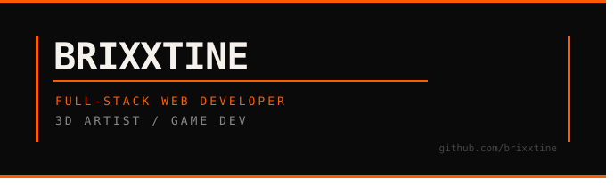

<div align="center">
  
</div>

<br/>

```
> full-stack web developer - 3D artist - game dev
> currently building Trigger3D - interactive 3D firearm visualization for criminology students
> learning React Three Fiber - Three.js - Supabase
> open to junior dev roles and freelance work
```

<br/>

### Stack

**Web**


**3D & Game Dev**


**Tools**


<br/>

